<p align="center">
  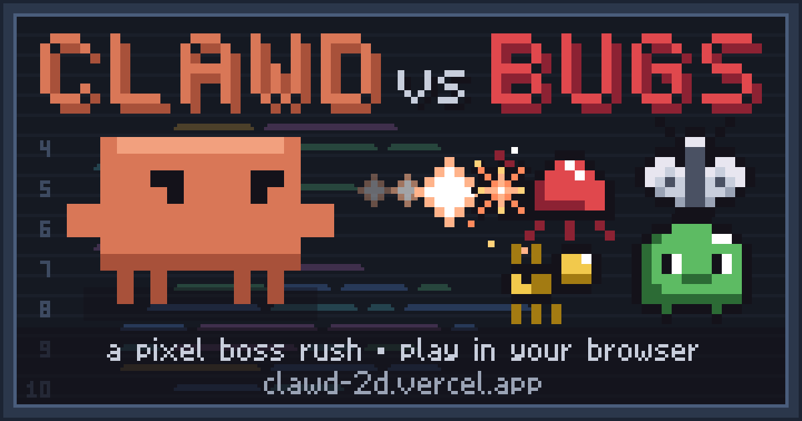
</p>

<p align="center">
  <b><a href="https://clawd-2d.vercel.app">▶ Play Clawd vs Bugs in your browser</a></b><br>
  keyboard and mouse · controller · phone or tablet · about 10 minutes a run · free
</p>

# Clawd vs Bugs

A top-down pixel boss rush. You play as Clawd and shoot your way through four software-bug bosses, fixing a codebase one stage at a time: `~/src/`, `~/node_modules/`, `~/.git/` and `~/prod/`.

<p align="center">
  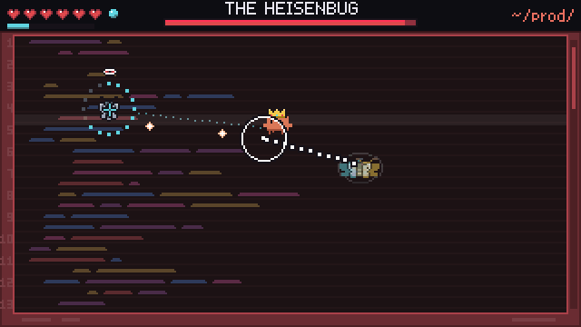<br>
  <sub>The final boss, the Heisenbug: only what you look at is real.</sub>
</p>

Fan game. Not affiliated with Anthropic.

**Status: v1.0, finished.** See the [changelog](CHANGELOG.md) for what's in it and [ideas for later](docs/IDEAS.md) for what could come next.

## Screenshots

| | |
|:---:|:---:|
| 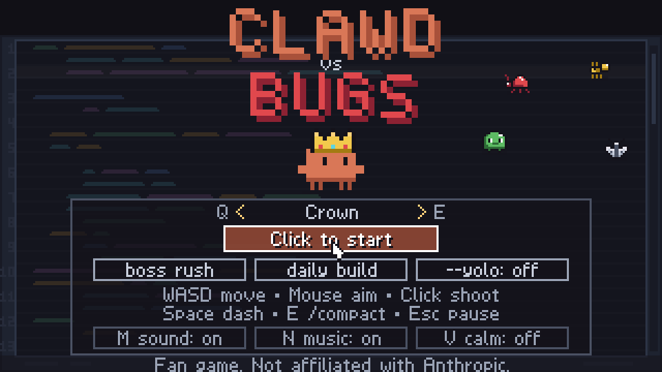<br><sub>The title menu</sub> | 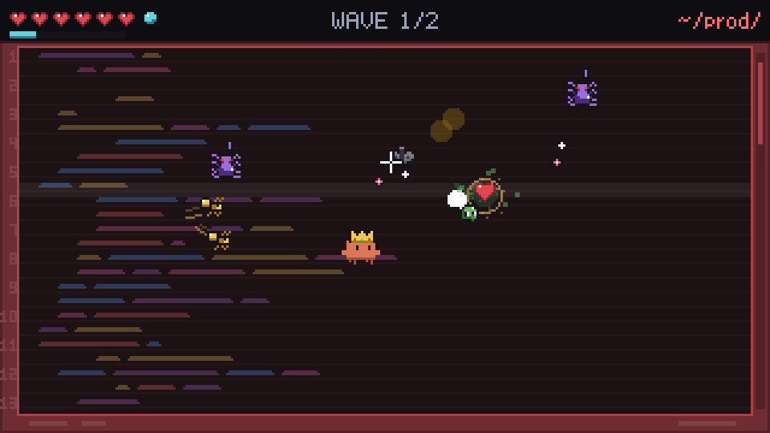<br><sub>A wave in <code>~/prod/</code></sub> |
| 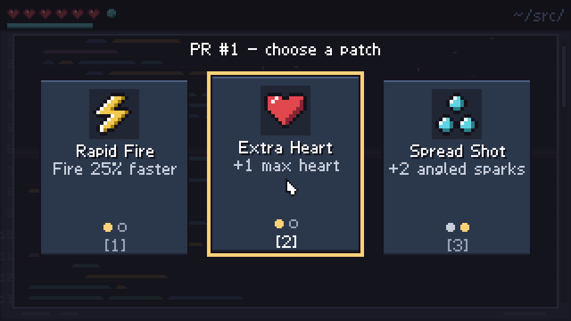<br><sub>Pick a patch after each boss</sub> | 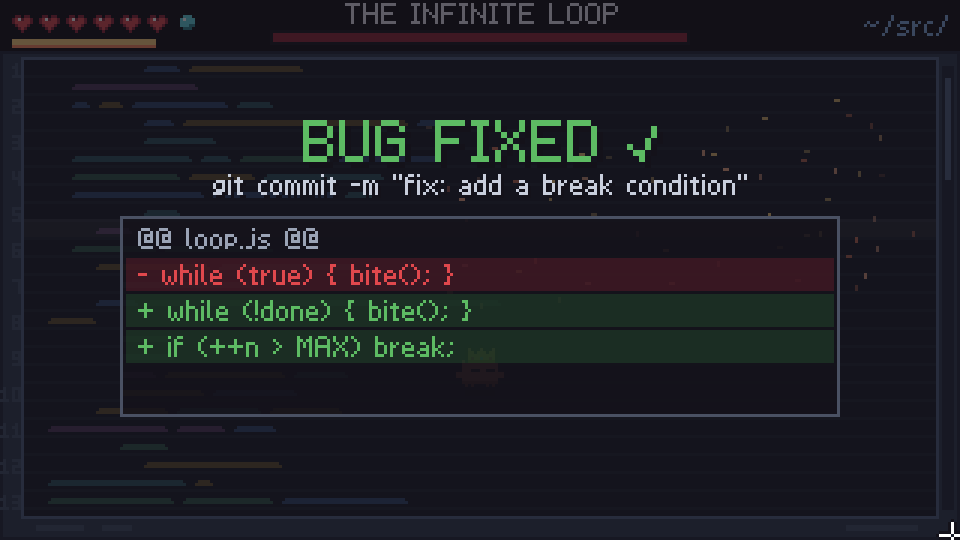<br><sub>Every boss ends with the diff that fixed it</sub> |
| 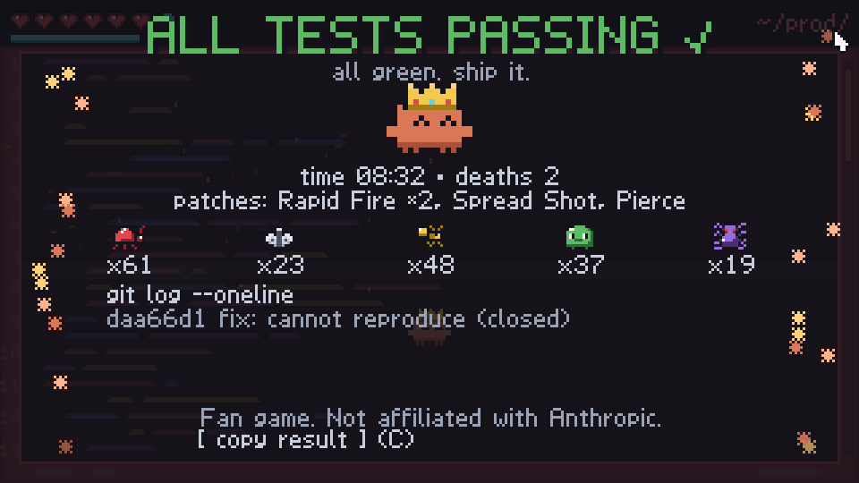<br><sub>The victory receipt, ready to copy and share</sub> | 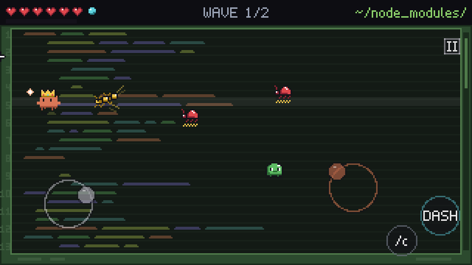<br><sub>Twin-stick touch controls on a phone</sub> |

## Play

- **Web:** https://clawd-2d.vercel.app (deployed from `main` on Vercel)
- **Install it:** tap **install** at the top right of the title screen. On Android and in desktop Chrome or Edge it opens the install prompt; on an iPhone or iPad it shows how to use Share → *Add to Home Screen*. The installed game opens fullscreen with its own icon and works offline after your first visit.
- **Locally:** `npm run serve`, then open http://127.0.0.1:8137/. You can also double-click `index.html`.

## How to play

- **Fight, then upgrade:** beat each stage's waves and boss, then pick a patch.
- **Watch the bars:** each boss has a trick, and the health bars and the screen hint at it. In `.git/`, watch the twins' bars; in `prod/`, watch what happens when you stare.
- **Use E:** /compact is your panic button. Every boss fight hands you one charge.
- **Grab P0 drops:** P0 elites and boss phase changes drop hotfix hearts, so go get them.

## Controls

The prompts on screen always match whatever you touched last: keyboard, controller or touch screen.

### Keyboard and mouse

| Input | Action |
|---|---|
| WASD or arrow keys | Move |
| Mouse | Aim |
| Left click (hold) | Shoot ✻ sparks |
| Space, Shift or right click | Dash, with a moment of invulnerability |
| E | Cast /compact when the context meter is full |
| Esc or P | Pause |
| M | Mute everything |
| N | Toggle music |
| V | Calm mode: no screen shake, softer flashes, slower blinking |
| 1, 2, 3 or click | Pick a patch after a boss |
| Arrows or A/D, then Enter | Move the focus and pick (patch pick, pause toggles) |
| R or click | Retry from the checkpoint (game over screen) |
| C | Copy your result (victory screen) |
| Q | Quit to the title (press twice from pause) |

<details>
<summary><b>Controller</b> (Xbox, PlayStation, Switch Pro)</summary>

Any standard controller works: Xbox, PlayStation or Switch Pro.

| Button | In a fight | In menus |
|---|---|---|
| Left stick or D-pad | Move | Move the focus (patch pick, pause toggles) |
| Right stick | Aim and auto-fire | |
| RT | Fire | |
| A | Dash | Confirm: start, pick, retry, play again |
| LB or LT | Dash | Title: previous hat (LB) |
| RB or B | Cast /compact | Title: next hat (RB) |
| Start | Pause and resume | |
| Back or Select | Quit (twice from pause, once from game over) | |
| Y / X | | Title, once unlocked: Boss Rush / toggle `--yolo` |
| B | | Title: today's daily build |
| X | | Victory screen: copy your result |

The controller rumbles when you get hit, at boss phase changes, on /compact and when a boss goes down.

</details>

<details>
<summary><b>Touch</b> (phone or tablet, in landscape)</summary>

| Touch | Action |
|---|---|
| Left thumb, anywhere on the left half | A move stick appears where you land |
| Right thumb, anywhere on the right half | An aim stick that fires while held |
| Quick tap on the arena | Shoots at the spot you tapped |
| DASH button | Dash |
| /c button | Cast /compact. It fills with the meter and glows when ready |
| II | Pause |
| Tap | Everything in menus: start, daily build, patches, retry, quit, play again, share your result |

On wide phones the sticks, DASH, /c and II sit in the black side bars, clear of the arena and of the notch, so your thumbs never cover the action. The first time, the sticks are labelled MOVE and AIM + FIRE. Starting a run goes fullscreen where the browser allows it. In portrait the game asks you to turn your phone, and a fight pauses until you do.

</details>

## Features

### The run

- Four stages, each a code-editor arena with its own palette:
  - `~/src/` (blue-grey)
  - `~/node_modules/` (murky green)
  - `~/.git/` (purple)
  - `~/prod/` (red, pulsing)
- Each stage plays out the same way:
  1. A terminal-style intro.
  2. Two short waves of bugs.
  3. A ⚠ WARNING card.
  4. The boss.
- **Checkpoints:**
  - Die to a boss and you retry the boss.
  - Die in wave 2 and you restart at wave 2.
  - Every retry has full hearts and a shorter intro.
- **Health:** 6 hearts. Hearts partly refill between waves and fully refill before each boss.

### Clawd

- A boxy terracotta Clawd that faces your aim, bobs, walks and blinks.
- **Expressions:** hurt, determined while dashing, worried at one heart, squinting when idle, happy when you win.
- **Feedback:** a muzzle flash, a little recoil, and squash and stretch on dashes and hits.
- **Idling** shows a "✻ Thinking..." bubble.
- **Dash:** a short burst with invulnerability frames and afterimages.

### Bugs

| Bug | What it does |
|---|---|
| Syntax Error | Red beetle with a squiggly underline. Walks straight at you. |
| Null Pointer | Pale moth. Vanishes, reappears next to you, then lunges. |
| Race Condition | Fast yellow ants that come in pairs and zigzag in opposite phase. |
| Memory Leak | Green blob that splits into two smaller blobs when popped. |
| Off-by-One | Purple spider. Keeps its distance and fires bursts aimed one tile ahead of where you're going. |

**P0 elites** wear a gold ring and a `P0` tag. They're tougher and faster, and they drop a hotfix heart when they die.

### Bosses

| | |
|:---:|:---:|
| 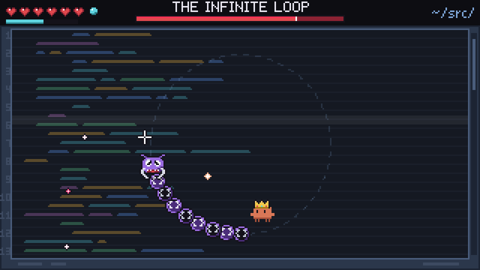<br><sub>The Infinite Loop</sub> | 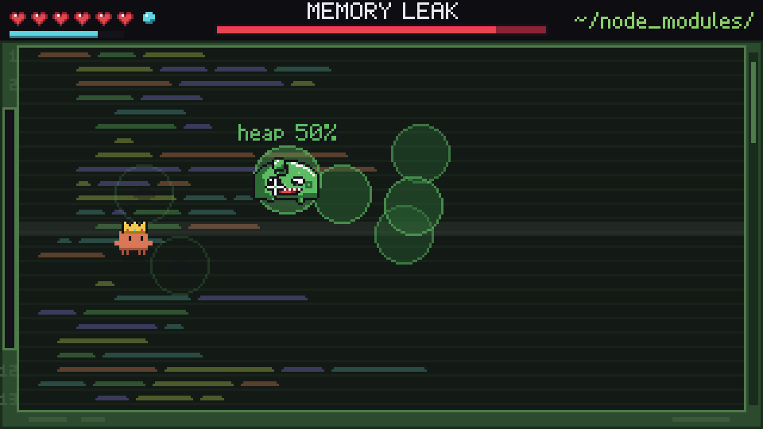<br><sub>Memory Leak</sub> |
| 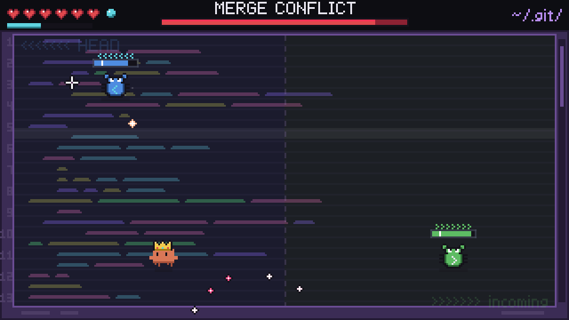<br><sub>Merge Conflict</sub> | 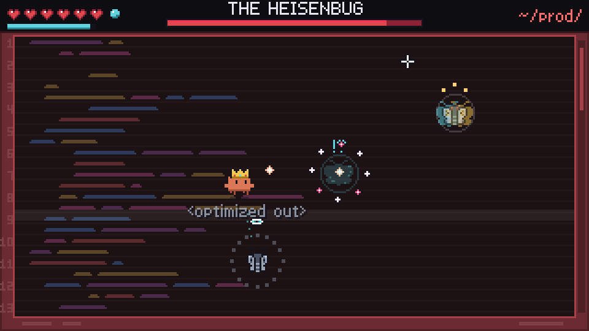<br><sub>The Heisenbug</sub> |

| Boss | Stage | Trick |
|---|---|---|
| **The Infinite Loop** | `~/src/` | A centipede circling the arena. Only its head takes damage, and its body blocks your shots. In phase 2 the circle tightens, it reverses direction and sheds segments that become Syntax Errors. |
| **Memory Leak** | `~/node_modules/` | A slime that heals and grows whenever you stop hurting it. It lobs blobs (watch their shadows) that land as sticky puddles: they slow you and burn on contact. It also splits off smaller leaks as it weakens. |
| **Merge Conflict** | `~/.git/` | Twin beetles, HEAD and incoming, that mirror each other and fire a beam between them. Kill one and you have 6 seconds to finish the other, or it comes back. Wear both down evenly. |
| **The Heisenbug** | `~/prod/` | Only what you look at is real. The moth under your crosshair turns to stone and is the only thing that takes damage, but staring overloads it: a ring fills, then it novas and jumps. Look away and the other moths are ghosts that ignore your bolts and hunt you from your blind side, lunging along a dotted line you can sidestep. Swap targets to cancel their lunges. At 60% a third moth splits off; below 25% they merge into a giant that is only awake while you look at it. |

- **Stagecraft:** each boss arrives with a glitching portrait on the warning card and an entrance burst. The arena also changes: an orbit ring for the Loop, a heap gauge for the Leak, a HEAD/incoming split for the Conflict, glitch bands for the Heisenbug.
- **Fair hits:** phase changes come with a freeze-frame, a shake and a scan line, and each one drops a hotfix heart near you.
- **Finale:** a defeated boss blows apart in a chain of 12 explosions. Then a **BUG FIXED ✓** card shows the commit message and the actual code diff that fixed it, ending in `✓ 1 test passing`.

### /compact and perfect dashes

- **Context meter:** every hit you land charges the bar under your hearts.
- **Casting:** when it's full, an `E` keycap floats above Clawd. Press it for a **/compact** shockwave that clears enemy bullets and puddles and damages every bug on screen ("Compacting conversation...").
- **Boss fights** always start with a full meter.
- **Perfect dash:** dash *through* an enemy bullet for a gold "perfect" and a chunk of meter.

### Patches

After each of the first three bosses you pick one of three patches.

| Patch | Effect | Max stacks |
|---|---|---|
| Spread Shot | +2 angled sparks | 2 |
| Rapid Fire | Fire 25% faster | 2 |
| Pierce | Sparks pass through +1 bug, +15% damage | 2 |
| Heavy Bolts | +35% damage, bigger sparks | 2 |
| Extra Heart | +1 max heart | 2 |
| Quick Dash | Dash recharges in 0.45 s | 1 |
| Ricochet | Sparks bounce off walls once | 1 |

Picking a patch makes Clawd celebrate.

### Juice and jokes

- **Bugs:** they pop in when they spawn, squash when hit, burst into debris and leave stains on the code floor.
- **Kill pops:** tool-call style, such as `Fix(;)`, `await` and `free()`.
- **Clawd's lines:**
  - stage intros read like a terminal prompt;
  - bosses taunt at phase changes;
  - every game over gets a crash line (`Segmentation fault (core dumped)`, `exit code 139`, …).
- **Victory screen:** `ALL TESTS PASSING ✓`, your time, deaths and patches, a tally of every bug you squashed by type, and a `git log` of the four fixes.
- **Transitions:** terminal-wipe scene changes (`$ ./clawd --fight`, `$ git reset --hard HEAD`).
- **Low health:** a heartbeat, a throbbing last heart and a red screen edge.

### Sound

- Every sound effect is synthesised live with Web Audio, with no audio files. Repeated sounds vary slightly in pitch so they don't grate.
- A procedural chiptune plays per stage. Each stage has its own scale and tempo, and each boss has its own loop that intensifies in phase 2.
- The music ducks under big moments.
- **M** mutes everything and **N** toggles just the music. Both settings are remembered.

### Unlocks and modes

- **Hats:** beating a boss earns its hat (Loop cap, Slime hat, Branch beanie, Shades). A full clear earns the Crown. Pick your hat on the title screen with Q/E (or LB/RB), or click or tap the arrows either side of its name. Until you have one, the title shows a dim `hats: beat a boss to earn one` line in the picker's place.
- **Boss Rush:** after your first victory, play all four bosses back to back. Until then it sits on the title as a locked, dashed button: hover it (or click, tap, or press Y) and it says `win a full run to unlock`.
- **`--yolo`:** a flag run with 3 base hearts, faster bullets and shorter mercy frames. Winning it earns a special hat. It is a locked, dashed button on the title until the same win unlocks it.
- **Secrets:** there are a couple for people who type the right things on the title screen.

### Daily build and sharing

- **Daily build:** one seeded run per day (UTC), the same for everyone. It ships with a starting patch picked for the day, and everyone is offered the same patches, so you can compare runs with friends. The title's daily build button gets a ✓ once you've cleared today's build, and the game keeps your best result for each day.
- **Share your run:** the victory screen has a `[ copy result ]` button (C on a keyboard, X on a controller). On a phone it opens the share sheet. The text looks like this:

  ```
  Clawd vs Bugs: ALL TESTS PASSING ✓
  ⏱ 08:42 · 💀 3 deaths · 🐛 214 bugs squashed
  🔧 Pierce, Spread Shot, Rapid Fire ×2
  📅 Daily build 2026-10-13
  https://clawd-2d.vercel.app
  ```

- **Link preview:** paste the link anywhere (Slack, Discord, X, iMessage) and it unfolds into a pixel-art card of Clawd fighting the bugs.

### Play your way

- **Three ways to play:** keyboard and mouse, a controller, or touch. Switch at any moment and every prompt switches with you ("Click to start", "Tap to start", "Press A to start").
- **Stick aim assist:** with a stick or a thumb, the aim gently snaps onto a regular bug within 10° of where you're shooting. It never helps on bosses, so the Heisenbug is always a matter of where you point the stick. Mouse aim is never assisted.
- **Toggles you can tap:** the title and pause screens have sound, music and calm toggles that work by click, tap or controller, so a phone needs no keyboard.
- **A title menu you can read:** START, daily build, Boss Rush and `--yolo` are framed buttons on one card (hover a mode button, or tap `--yolo`, for a one-line description of it), with a short controls legend and the toggles underneath. A red double frame means `--yolo` is on.
- **Controller extras:** rumble, a "controller connected" toast, and an automatic pause if the controller disconnects mid-fight.

### Comfort and robustness

- **Calm mode (V):** turns off screen shake and rumble, swaps full-screen flashes for edge glows and slows fast blinking. It's on by default if your system asks for reduced motion.
- **Scaling:** whole-number pixel scaling with letterboxing fits any window and keeps the pixel art crisp.
- **Auto-pause:** the game pauses when the tab loses focus.
- **Crash screen:** if anything ever breaks, a **KERNEL PANIC** screen shows the error. Press R (or tap) to reload.
- **No dependencies:** no npm packages and no audio files. The only images are the link preview and app icons, and those are drawn from the game's own sprites. There's no build step needed to play locally.

## For developers

### Tests and debug URLs

```bash
npm test
```

This runs about 1,570 headless tests with `node:test`. They include a bot that plays every stage in invincible mode, checks every boss can be beaten, and prints a difficulty report.

Debug URLs work only on localhost or `file://`, never on a deployed page:

| Hash | Effect |
|---|---|
| `#stage=3` | Start at stage 3 |
| `#stage=3&boss` | Skip the waves and go straight to the boss |
| `#god` | Invincible |
| `#seed=42` | Fixed run seed |
| `#speed=4` | Simulation speed multiplier (1–8) |
| `#patches=spread,rapid,rapid` | Start with patches |
| `#hitboxes` | Draw hitboxes |
| `#rush`, `#yolo` | Boss Rush / YOLO mode |

`window.CB.debug.run` exposes the live run in the console.

### Building

| Command | Output | Used for |
|---|---|---|
| `npm run build:site` | `public/`: the page, one content-hashed bundle of all 53 scripts (`game.<hash>.js`, about 120 KB gzipped) with a source map, a service worker for offline play, the app manifest and the images. Tests, docs and tools stay out. | Static hosting (Vercel). |
| `npm run build` | `dist/clawd-vs-bugs.html`: every script inlined into one file (one `<script>` per source file, with `sourceURL` comments so stack traces name the real file). | The claude.ai Artifact version. |

### Deploying (Vercel)

- `vercel.json` sets `framework: null`, runs `node tools/build-site.mjs` and serves `public/`.
- Pushing to `main` deploys production through the Vercel Git integration.
- **Caching:**
  - The bundle's name changes with its content, so browsers cache it forever.
  - The page itself is always checked for a new version.
  - The service worker loads the page from the network first, so a new deploy shows up on the next visit and offline play still works.
- **Analytics:** the deployed page (never the dev page) loads cookieless Vercel Web Analytics once it is switched on in the Vercel dashboard (project, Analytics, Enable); until then it only makes one quiet HEAD check and loads nothing.
- Preview deployments stay behind Vercel Authentication. The production domain is meant to be public; that's set under the project's Deployment Protection settings.

Regenerate the link preview card and app icons with `npm run art` after changing Clawd, a bug sprite, the palette or the font (a test fails until you do).

### How it's built

- Plain JavaScript classic scripts on one global, `window.CB`, rendered with Canvas 2D on a 320×180 buffer scaled up with integer scaling.
- Game logic is deterministic: a seeded RNG and a fixed 60 Hz step, with drawing kept separate. The whole game can therefore run headless in Node for tests and the playthrough bot.
- Every sprite is a string of palette characters in the source. Sound effects and music are synthesised with Web Audio.
- The link preview card and app icons are rendered from those same sprites and the bitmap font by `tools/make-art.mjs`, which has its own tiny rasterizer and PNG encoder and gives byte-identical output on every run.
- Design docs: the base spec is `docs/superpowers/specs/2026-10-06-clawd-vs-bugs-design.md`, with later specs beside it (controller and touch, the Heisenbug redesign, the title menu). The implementation plan and balance log are in `docs/superpowers/plans/`.
- The screenshots in this README are real frames captured from the game with the test bot playing (`docs/screenshots/`).
